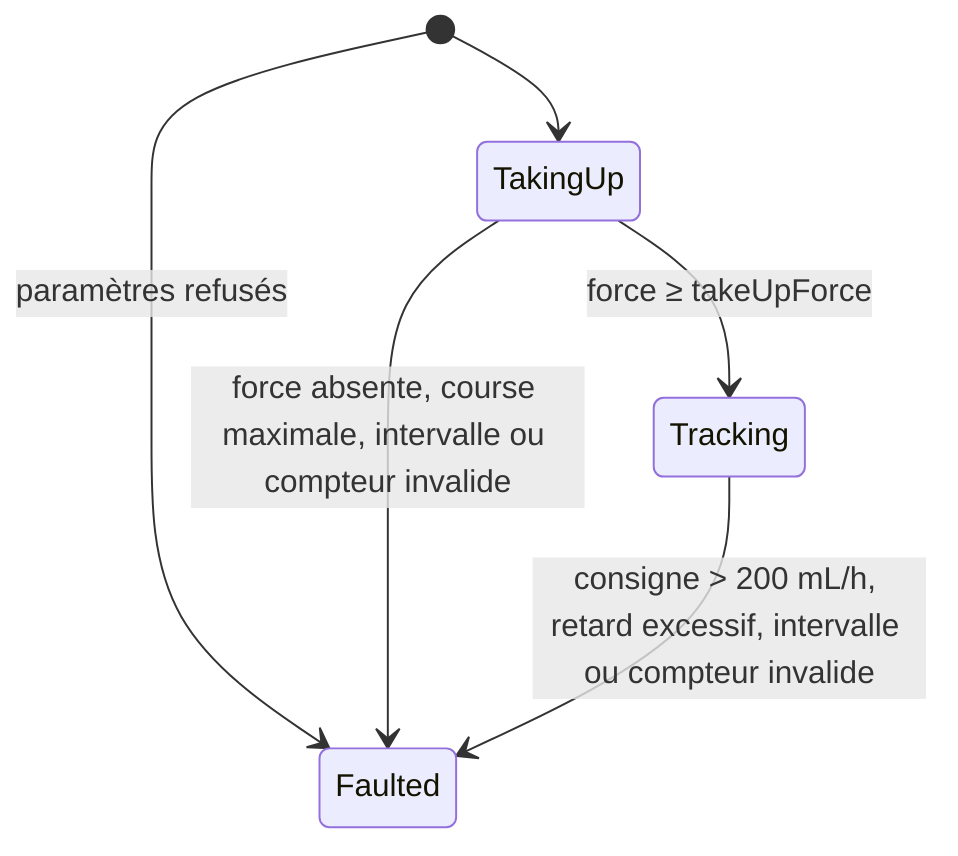

# Asservissement du moteur et précision de débit

| Champ | Valeur |
| --- | --- |
| Statut | Conception détaillée, soumise à relecture |
| Issue | [#26](https://github.com/camille-martin-paris/clepsydre/issues/26) |
| Exigences et mesures | SYS-REQ-003 (CTRL-002), SYS-REQ-048 (CTRL-027), SYS-REQ-043 (CTRL-024), SYS-REQ-047 ; SW-REQ-005, SW-REQ-006 ([spécification](../requirements/requirements-specification.md)) |
| Décisions | [ADR 0002](../adr/0002-principe-de-pompage.md) (pousse-seringue), [ADR 0003](../adr/0003-architecture-de-calcul-et-canal-de-securite.md) (vitesse bornée par conception, canal de sécurité) |
| Code | [`src/control/`](../../src/control/) : module `clepsydre.control.drive` |
| Classe de sécurité | C ([classification](../../software_development_file/safety-classification.md)) |

> [!CAUTION]
> Clepsydre ne doit pas être utilisé sur un être humain ni sur un animal. Les résultats de simulation ci-dessous valent pour le modèle et ses paramètres d'exemple. La précision de débit (SYS-REQ-003) et le délai au premier écoulement (SYS-REQ-048) se mesurent sur banc ([#73](https://github.com/camille-martin-paris/clepsydre/issues/73)).

## Objet

Ce document décrit l'unité d'asservissement du moteur du logiciel de commande (IEC 62304 §5.4). Elle remplit deux rôles :
- **rattraper les jeux** avant la perfusion : avancer le pousseur jusqu'à fermer le jeu de l'écrou et précontraindre le joint du piston, sans rien délivrer (CTRL-027) ;
- **commander le moteur en position** pendant la perfusion : le pousseur suit l'intégrale exacte de la consigne de débit, convertie en pas selon la section du modèle de seringue identifié (CTRL-002).

Comme les unités voisines, elle ne lit aucun capteur et ne pilote aucun matériel elle-même. Elle reçoit à chaque période les mesures et la consigne, et rend le nombre de pas à émettre. Elle ne fait ni allocation dynamique ni exception.

## Contexte

Avec un pousse-seringue, le volume délivré est le produit de la course du piston par la section de la seringue (ADR 0002). Deux causes d'erreur relèvent du logiciel de commande :
- **la conversion** du débit en vitesse du moteur. Une erreur d'arrondi qui se cumule fausse le débit, et le volume, sur toute la perfusion ;
- **le retard au démarrage**. Avant tout écoulement, l'écrou parcourt le jeu, puis le pousseur comprime le joint jusqu'à vaincre son frottement statique. À 1 mL/h, le modèle physique donne environ 13 min avec la seringue de 50 mL d'exemple ([simulateur](../development/simulator.md#comportements-reproduits)), au-delà des 5 min de SYS-REQ-048.

Les autres causes ne relèvent pas de cette unité : section réelle de la seringue (tolérance du fabricant, identification, SYS-REQ-047), mécanique (pas de vis, jeu, rigidité), pas perdus par le moteur. La dernière est surveillée par le canal de sécurité (CTRL-001) et par la détection d'actionneur inactif (SYS-REQ-004).

## Entrées et sorties

### Paramètres

**Mécanisme** (`DriveMechanism`), valeurs de conception communes à toutes les seringues (#52) :

| Paramètre | Unité | Plage admise | Rôle |
| --- | --- | --- | --- |
| `screwLeadNanometres` | nm par tour | 1 à 10⁷ (10 mm) | Avance de l'écrou par tour de vis |
| `stepsPerRevolution` | pas par tour | 1 à 65 536 | Micro-pas compris |
| `maxStepRate` | pas/s | 1 à 100 000 | Vitesse maximale du moteur, bornée par le matériel (SYS-REQ-043) |
| `takeUpStepRate` | pas/s | 1 à `maxStepRate`, et au moins un pas par période | Vitesse du rattrapage |
| `period` | ms | 1 à 100 | Période de la boucle de commande |

**Seringue** (`SyringeDrive`), pour chaque modèle de la liste des seringues vérifiées (SYS-REQ-047), mesuré sur banc (#73) :

| Paramètre | Unité | Plage admise | Rôle |
| --- | --- | --- | --- |
| `strokeVolume` | nL/mm | 1 à 10⁶ (1 000 mm²) | Volume chassé par millimètre de course : la section intérieure |
| `takeUpForce` | mN | strictement positive | Force qui termine le rattrapage, sous le frottement statique du joint |
| `takeUpTravel` | µm | 1 à 10 000, et au moins un pas | Course maximale du rattrapage : jeu, compression du joint jusqu'à `takeUpForce`, marge |

`validDriveParameters()` vérifie ces plages. Elle vérifie aussi que les pas du débit maximal de la pompe (200 mL/h) sur une période, arrondis par excès, peuvent être émis pendant cette période sous `maxStepRate` avec cette seringue. C'est le plafond d'une commande ([Commande en position](#commande-en-position-ctrl-002)) : toute commande est réalisable par le moteur, et une consigne admise n'est jamais limitée par le matériel. Des paramètres refusés verrouillent l'entraînement en défaut (`InvalidParameters`) dès sa construction : il ne demande aucun pas.

Les plages garantissent aussi les calculs : le produit débit × intervalle × numérateur reste sous 3,3 × 10¹⁵, et le diviseur sous 9 × 10¹³. Aucun calcul ne déborde 64 bits.

### Appel périodique

`update(elapsed, setpoint, stepCount, force)` est appelé à chaque période, avec :
- l'intervalle écoulé depuis l'appel précédent, mesuré sur le compteur monotone (SW-REQ-018) ;
- la consigne du mode actif, déjà vérifiée contre sa borne par le décompte (`Delivery`, SW-REQ-006) ;
- le compteur des pas émis par le générateur d'impulsions ;
- la force mesurée sur le pousseur, absente si le capteur ne rend rien.

Il rend une commande (`DriveCommand`) : le nombre de pas que le générateur doit émettre, régulièrement espacés, pendant la période suivante. Les pas sont toujours vers l'avant : le recul relève de la [décompression après occlusion](occlusion.md#décompression-ctrl-008) (#27).

## Phases

| Phase | Pas demandés | Fin |
| --- | --- | --- |
| `TakingUp` | `takeUpStepRate` × période, tronqués à la course restante. La consigne est ignorée | Force mesurée au moins égale à `takeUpForce` : passage en `Tracking`, sans pas pour cette période |
| `Tracking` | Intégrale de la consigne sur l'intervalle, convertie en pas, plus le retard ; au plus les pas du débit maximal sur une période | — |
| `Faulted` | Aucun | Verrouillée : un nouvel entraînement est construit pour une nouvelle perfusion |

### Rattrapage des jeux (CTRL-027)

Un entraînement commence toujours par le rattrapage : au démarrage comme à la reprise après une pause. À la reprise, le jeu est déjà fermé et le joint précontraint, sauf après un recul : la force est atteinte au premier relevé, et le rattrapage ne dure qu'une période.

- **Fin par la force.** Le pousseur avance à `takeUpStepRate` jusqu'à ce que la force atteigne `takeUpForce`. Cette force est choisie, pour chaque modèle, sous le frottement statique du joint : le piston ne bouge pas, et le rattrapage ne délivre rien. Il reste alors au joint à se comprimer de l'écart entre `takeUpForce` et le frottement statique, au lieu de toute sa course.
- **Course maximale.** Si la force n'est pas atteinte après `takeUpTravel`, l'entraînement passe en défaut (`TakeUpTravelExceeded`). La force n'est jugée qu'une fois la dernière commande émise : tant qu'il en reste plus d'un pas à émettre, l'entraînement attend une période sans demander de pas, et le contrôle du compteur exige ensuite cette émission. Un générateur en retard admis d'une commande ne provoque donc pas de défaut à tort. C'est le cas d'une seringue absente ou mal placée, d'un piston non capturé, d'un moteur calé ou d'un capteur de force figé. La course maximale borne le volume qu'un capteur de force défaillant laisserait pousser : au plus `takeUpTravel` × section, soit 0,20 mL avec les valeurs de la [simulation](#vérification-en-simulation) pour la seringue de 50 mL. Choisie sous le frottement statique, elle ne délivre rien.
- **Force absente.** Sans mesure, le rattrapage ne peut pas finir : défaut (`ForceUnavailable`).
- **Perfusion décomptée à partir du contact.** La consigne est ignorée pendant le rattrapage. La perfusion, et son décompte par `Delivery`, commencent à la période où la phase passe à `Tracking`. Le pousseur ne rattrape donc jamais le temps du rattrapage par une vitesse supérieure à la borne du mode : le canal de sécurité, qui compare la vitesse du piston à cette borne sur 2 s (SYS-REQ-001), ne voit aucun excès.
- **Vitesse.** Le rattrapage déplace le pousseur, pas le piston : sa vitesse n'est pas une consigne de débit. Elle est bornée par `takeUpStepRate`, lui-même au plus égal à la vitesse maximale du moteur, et sa course par `takeUpTravel`.

### Commande en position (CTRL-002)

Le pas à pas tourne en boucle ouverte : sa position est le nombre de pas émis. L'entraînement tient la **position commandée** du pousseur, et demande à chaque période les pas qui la font suivre l'intégrale de la consigne.

Un pas chasse `strokeVolume` × `screwLeadNanometres` / (10⁶ × `stepsPerRevolution`) nL. Un débit de *r* µL/h pendant *t* ms délivre *r t* / 3 600 nL. Le nombre de pas vaut donc :

*pas* = *r* × *t* × `stepsPerRevolution` × 2 500 / (9 × `strokeVolume` × `screwLeadNanometres`)

Le reste de la division est reporté au cycle suivant : la somme des pas dus est exactement la partie entière de l'intégrale de la consigne, quelle que soit la suite des intervalles et des consignes. Aucune erreur d'arrondi ne se cumule.

**Plafond d'une commande et retard.** L'intervalle intégré est l'intervalle passé, alors que la commande est émise pendant la période suivante. Après un intervalle plus long que la période, les pas dus ne peuvent pas tous être émis dans la période sans dépasser la vitesse visée. Chaque commande est donc plafonnée aux pas que le débit maximal de la pompe demande sur une période, arrondis par excès ; la validation des paramètres garantit que ce plafond tient sous `maxStepRate`. Le reste est un **retard** explicite (`backlogSteps()`), rattrapé aux périodes suivantes dans la limite du même plafond :
- la somme des pas demandés et du retard reste à chaque période égale à la partie entière de l'intégrale ;
- le pousseur ne dépasse jamais, sur une période, la vitesse du débit maximal de la pompe ;
- le retard est borné aux pas de `maxStep` (100 ms) au débit maximal. Au-delà, la boucle de commande manque ses échéances de façon répétée : défaut `TrackingLag`.

Le rattrapage d'un retard peut dépasser brièvement la consigne du mode, d'au plus le volume de 100 ms au débit maximal (5,6 µL), ce qui reste négligeable devant la fenêtre de 2 s du canal de sécurité. En fonctionnement nominal, l'intervalle égale la période, le plafond n'est jamais atteint, et la position commandée retarde d'une période au plus, et d'un pas, sur l'intégrale. La relecture de #130 a relevé ce point : une commande, auparavant non plafonnée, pouvait exiger après un intervalle de 100 ms dix fois la vitesse du moteur.

Avec la seringue de 50 mL d'exemple et la vis de 1 mm à 3 200 pas par tour, un pas chasse 0,17 µL. À 0,1 mL/h, le pousseur avance d'un pas toutes les 6,3 s ; à 200 mL/h, de 320 pas par seconde.

### Contrôle du compteur de pas

Le compteur relu à chaque période doit rester entre sa valeur précédente et la position demandée, et avoir émis toutes les commandes antérieures à la dernière, à un pas près. Le pas de tolérance couvre un générateur qui reporte sa fraction de pas. Sinon :
- compteur qui recule, ou qui dépasse les pas demandés : `CounterInconsistent` ;
- pas demandés non émis : `StepsNotEmitted`.

Pendant le rattrapage, la dernière commande est attendue avant de juger la course épuisée ([Rattrapage des jeux](#rattrapage-des-jeux-ctrl-027)). La relecture de #130 a relevé ce point : un générateur en retard d'une commande, retard admis par ce contrôle, menait sinon à `TakeUpTravelExceeded` alors que la course n'était pas parcourue.

Le compteur ne voit que les pas émis par le processeur. Il ne voit pas les pas que le moteur perd ou exécute en trop : le capteur de position du piston du canal de sécurité les voit (SYS-REQ-001, ADR 0003). Le codeur moteur que l'ADR 0003 envisage pour la commande pourra s'ajouter à ce contrôle quand les capteurs seront retenus (#58).

## Défauts

Tout défaut est **verrouillé** : l'entraînement ne demande plus aucun pas, et chaque appel rend la même cause. L'appelant applique `DangerDetected` à la [machine à états](state-machine.md), qui place la pompe en état sûr (SYS-REQ-002). Les valeurs des causes sont stables : elles seront journalisées dans le détail des événements d'audit ([vocabulaire des événements](../event-vocabulary.md)).

| Défaut | Valeur | Cause |
| --- | --- | --- |
| `InvalidParameters` | 1 | Mécanisme ou seringue hors des plages admises, ou 200 mL/h au-delà de la vitesse maximale du moteur |
| `InvalidStep` | 2 | Intervalle négatif ou supérieur à `maxStep` (100 ms) : la boucle de commande a manqué ses échéances |
| `SetpointAboveMaximum` | 3 | Consigne au-delà de 200 mL/h, débit maximal de la pompe |
| `ForceUnavailable` | 4 | Aucune mesure de force pendant le rattrapage |
| `TakeUpTravelExceeded` | 5 | Course maximale du rattrapage atteinte sans la force attendue |
| `CounterInconsistent` | 6 | Compteur qui recule, ou qui dépasse les pas demandés |
| `StepsNotEmitted` | 7 | Pas demandés avant la dernière commande non émis |
| `TrackingLag` | 8 | Retard sur l'intégrale de la consigne au-delà des pas de 100 ms au débit maximal |

La borne de consigne du mode actif reste vérifiée par le décompte, avant l'appel (SW-REQ-006). L'entraînement ne refait que le contrôle du débit maximal de la pompe, qui garantit ses calculs.

## Intégration dans la boucle de commande

À chaque période, la boucle de commande :
1. lit le compteur monotone, le compteur de pas et la force ;
2. si l'entraînement est en `Tracking`, fait avancer le décompte (`Delivery::advance()`) sur l'intervalle, et applique l'événement rendu à la machine à états ;
3. appelle `update()` avec la consigne du mode actif (`Delivery::setpoint()`), nulle hors des modes de perfusion ;
4. transmet les pas au générateur, ou applique `DangerDetected` sur un défaut.

L'entraînement est construit au démarrage ou à la reprise de la perfusion, et abandonné à la pause, à l'arrêt et en état sûr. Cette boucle viendra avec le logiciel de commande assemblé ; les tests en simulation en reproduisent les étapes 1, 3 et 4.

## Ressources

- **Mémoire** : un entraînement occupe une centaine d'octets ; aucune allocation dynamique.
- **Exceptions** : toutes les fonctions sont `noexcept`.
- **Temps d'exécution** : constant, sans boucle.

## Vérification

### Tests unitaires

Les tests de [`tests/control_drive_test.cpp`](../../tests/control_drive_test.cpp) calculent leurs attendus à la main, avec une seringue de 500 mm² : un pas chasse 156,25 nL, et 1 mL/h vaut 6 400 pas par heure.

| Critère (IEC 62304 §5.5.4) | Couverture par les tests |
| --- | --- |
| Valeurs et limites | Chaque plage de paramètres, valeurs refusées et limites exactes admises ; plafond d'une commande à 200 mL/h juste sous et juste au-delà de la vitesse maximale du moteur ; course de rattrapage d'un pas |
| Rattrapage | 20 pas par période jusqu'à la force, consigne ignorée ; force atteinte au premier relevé ; course maximale épuisée puis défaut ; générateur en retard d'une commande jusqu'à la dernière : attente, puis perfusion si la force est atteinte, défaut sinon, ou défaut du générateur si la commande n'est jamais émise ; dernière commande tronquée à la course ; force absente |
| Conversion | 1 mL/h pendant 1 h : exactement 6 400 pas, jamais plus d'un par période ; 200 mL/h pendant 1 h : 1 280 000 pas ; 200 000 périodes d'intervalles et de consignes irréguliers, somme égale à chaque période à la partie entière de l'intégrale exacte |
| Retard | Intervalle de 100 ms à 200 mL/h avec un moteur à 400 pas/s : 4 pas, 31 en retard ; à chaque période suivante, pas demandés et retard égaux à l'intégrale, jamais plus de 4 pas, retard rattrapé ; deux intervalles de 100 ms de suite : `TrackingLag` |
| Compteur | Dernière commande non encore émise, un pas de retard admis ; deux pas de retard, compteur qui recule ou qui dépasse : défaut |
| Défauts | Intervalles nul et maximal admis, négatif et trop long refusés ; consigne au-delà de 200 mL/h ; défaut verrouillé malgré le retour de la force |
| Couverture structurelle | 100 % des régions et des branches visés, sans exclusion (tâche CI `coverage`) |

### Vérification en simulation

[`tests/control_drive_sim_test.cpp`](../../tests/control_drive_sim_test.cpp) ferme la boucle avec le [modèle physique du pousse-seringue](../development/simulator.md) : à chaque période de 10 ms, l'entraînement lit le compteur de pas et la force quantifiée du modèle, puis le moteur simulé émet les pas demandés.

Les paramètres d'entraînement sont tirés des seringues d'exemple, comme le banc les mesurerait : section nominale, fin du rattrapage aux trois quarts du frottement statique, course du jeu et de la compression du joint jusqu'à cette force, avec 25 % de marge.

**Délai au premier écoulement à 1 mL/h** (plus de 1 µL sorti de la seringue) :

| Seringue | Sans rattrapage | Durée du rattrapage | Avec rattrapage | Volume délivré par le rattrapage |
| --- | --- | --- | --- | --- |
| exemple 10 mL | 195 s | 0,41 s | 47 s | 0 µL |
| exemple 20 mL | 376 s | 0,45 s | 93 s | 0 µL |
| exemple 50 mL | 805 s | 0,49 s | 205 s | 0 µL |

Le rattrapage ramène le délai sous les 5 min de SYS-REQ-048 pour les trois seringues d'exemple. Le délai restant est la compression du joint de `takeUpForce` jusqu'au frottement statique, à la vitesse du débit. Il raccourcit si `takeUpForce` se rapproche du frottement statique, au prix d'une marge plus faible sur la dispersion du frottement entre seringues d'un même modèle. Ce compromis se règle sur banc, modèle par modèle.

**Précision du débit en régime établi**, aux débits de 0,1, 1, 5, 25, 100 et 200 mL/h, pour chaque seringue d'exemple. Mise en régime : la première heure, au plus le temps de délivrer le quart du volume utile. Fenêtre de mesure : une heure, au moins le temps de délivrer 1 mL, au plus celui de délivrer la moitié du volume utile. Les extrêmes sur des fenêtres glissantes de 2 et de 31 min, relevées toutes les 30 s, suivent la méthode des courbes en trompette de l'IEC 60601-2-24, sans en revendiquer la conformité.

| Résultat | Valeur obtenue |
| --- | --- |
| Erreur du débit moyen, 18 combinaisons de seringue et de débit | 0,002 % au plus |
| Extrêmes sur 2 min à 0,1 mL/h | −0,8 % à +1,4 % ; la quantification d'un pas toutes les quelques secondes |
| Extrêmes sur 2 min à 1 mL/h et au-delà ; sur 31 min à tous les débits | 0,1 % au plus |

Le modèle n'a pas d'autre source d'erreur que celles qu'il contient : l'asservissement le suit exactement, et ces résultats montrent seulement que la conversion ne dérive pas et ne quantifie pas au-delà d'un pas. Ils ne disent rien de la précision de la pompe : le modèle ignore la tolérance du pas de vis, la déformation du mécanisme, la dépendance du frottement à la vitesse et la compliance de l'air ([limites du modèle](../development/simulator.md#limites-du-modèle)).

**Écart de section au modèle de la liste.** Une seringue dont le diamètre intérieur s'écarte de 1 % du modèle choisi donne, à 5 mL/h, une erreur de −1,99 % et de +2,01 % : exactement l'écart des sections, que l'asservissement ne peut pas voir. La précision dépend donc d'abord de l'identification de la seringue (SYS-REQ-047) et de la section mesurée pour chaque modèle (#73).

**Défauts pendant le rattrapage**, seringue de 50 mL : capteur de force perdu (`ForceUnavailable`), capteur de force figé à zéro, seringue mal placée, seringue absente et moteur calé (`TakeUpTravelExceeded`). Chaque fois, le moteur s'arrête et le volume délivré reste sous celui de la course maximale ; avec le capteur figé, rien n'est délivré.

Ces tests préparent les essais sur banc de SYS-REQ-003 (VER-004) et SYS-REQ-048 (VER-111), qu'ils ne remplacent pas ([stratégie de vérification](../../software_development_file/verification-strategy.md#niveau-attendu-par-type-dexigence)). La reprise sur banc relève de #73.

## Points soumis à la relecture

1. **Rattrapage dans l'état de perfusion.** La machine à états n'a pas d'état propre au rattrapage. Il se fait au début de `Infusing`, en mode `Infusion`, et le décompte commence au contact. Le rattrapage déplace le pousseur sans délivrer : cette conception le traite comme un mouvement hors consigne de débit, borné en vitesse et en course, et non comme une consigne au sens de SW-REQ-006. Une révision de SW-REQ-006, ou un sous-état de la machine, rendrait ce choix explicite.
2. **Force de fin de rattrapage.** Les trois quarts du frottement statique sont un ordre de grandeur pour la simulation. La valeur de chaque modèle, et sa marge sur la dispersion du frottement, viendront du banc (#73).
3. **Défaut verrouillé.** Un défaut de l'entraînement mène à l'état sûr, comme toute condition dangereuse. Un défaut du rattrapage (seringue mal placée, piston non capturé) pourrait plutôt bloquer le démarrage avec une alarme dédiée ; ce choix relève du catalogue des alarmes (#31) et de la détection de l'absence de consommable (#28).

## Limites

- **Boucle ouverte sur le moteur.** Le compteur de pas ne voit pas les pas perdus. Leur détection relève du canal de sécurité (CTRL-001) et de la détection d'actionneur inactif (SYS-REQ-004).
- **Pas de recul.** La détection d'occlusion par la force (CTRL-007) et la décompression qui la suit (CTRL-008) relèvent d'une unité distincte, qui remplace l'entraînement dès la détection ([conception détaillée](occlusion.md), #27).
- **Générateur d'impulsions.** Le contrat retenu (les pas demandés sont émis, régulièrement espacés, pendant la période suivante) est à confirmer avec la carte de commande (#57).
- **Vitesse bornée par conception.** `maxStepRate` reprend la borne matérielle de SYS-REQ-043 : l'entraînement vérifie qu'une commande au débit maximal de 200 mL/h tient dessous. La borne elle-même est matérielle, et sa vérification relève de l'analyse et du banc (VER-103, VER-104).
- **Paramètres.** Toutes les valeurs numériques de la simulation sont des ordres de grandeur, non mesurés.
