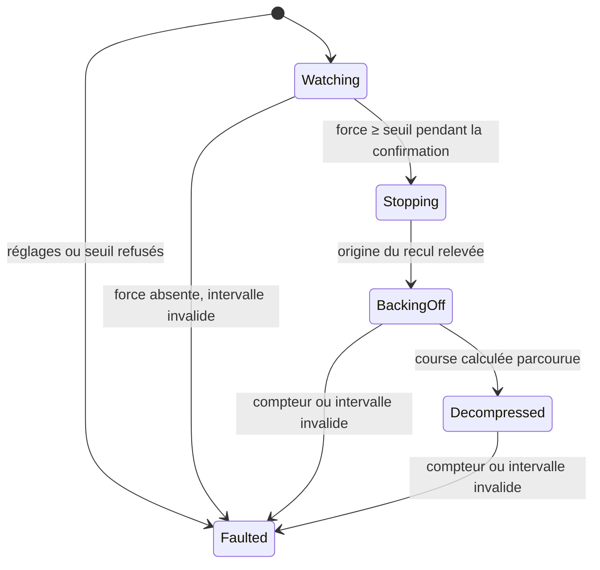

# Détection d'occlusion et décompression

| Champ | Valeur |
| --- | --- |
| Statut | Conception détaillée, soumise à relecture |
| Issue | [#27](https://github.com/camille-martin-paris/clepsydre/issues/27) |
| Exigences et mesures | SYS-REQ-008 (CTRL-007, RISK-005), SYS-REQ-009 (CTRL-008, RISK-006), SYS-REQ-047 ; SW-REQ-018 ([spécification](../requirements/requirements-specification.md)) |
| Décisions | [ADR 0002](../adr/0002-principe-de-pompage.md) (pousse-seringue, occlusion par la force, décompression par recul), [ADR 0003](../adr/0003-architecture-de-calcul-et-canal-de-securite.md) (voie de secours du canal de sécurité) |
| Code | [`src/control/`](../../src/control/) : module `clepsydre.control.occlusion` |
| Classe de sécurité | C ([classification](../../software_development_file/safety-classification.md)) |

> [!CAUTION]
> Clepsydre ne doit pas être utilisé sur un être humain ni sur un animal. Les résultats de simulation ci-dessous valent pour le modèle et ses paramètres d'exemple. Le délai d'alarme d'occlusion (SYS-REQ-008) et le bolus post-occlusion (SYS-REQ-009) se mesurent sur banc ([#74](https://github.com/camille-martin-paris/clepsydre/issues/74)).

## Objet

Ce document décrit l'unité de détection d'occlusion du logiciel de commande (IEC 62304 §5.4). Elle remplit deux rôles :
- **détecter une occlusion aval** par la force sur le pousseur, au seuil choisi dans les bornes du modèle de seringue (CTRL-007) ;
- **décomprimer** la seringue après la détection : le pousseur recule d'une course calculée selon la force à la détection, pour limiter le bolus libéré à la levée de l'occlusion (CTRL-008).

Comme l'[asservissement](drive.md), elle ne lit aucun capteur et ne pilote aucun matériel elle-même. Elle reçoit à chaque période les mesures, et rend l'occlusion détectée et le nombre de pas de recul à émettre. Elle ne fait ni allocation dynamique ni exception.

## Contexte

Avec un pousse-seringue, une occlusion en aval arrête l'écoulement, mais pas le pousseur : le volume qu'il chasse se stocke dans la compression du joint du piston et dans l'élasticité du corps et du prolongateur, et la force sur le pousseur monte (ADR 0002). Deux dangers en découlent :
- **RISK-005** : l'occlusion n'est pas détectée, ou trop tard, et le patient ne reçoit plus son traitement. La force monte d'autant plus lentement que le débit est faible et que la seringue est grande et élastique : à 1 mL/h, plusieurs minutes séparent le début de l'occlusion du seuil ;
- **RISK-006** : à la levée de l'occlusion, le volume stocké part en bolus, en quelques secondes. Avec la seringue de 50 mL d'exemple, il dépasse 0,6 mL au seuil le plus élevé.

L'ADR 0002 fixe les mesures : la « détection amont » est sans objet pour un pousse-seringue ; l'occlusion aval est détectée par la force, avec des seuils par modèle de seringue ; la décompression est un recul du pousseur d'une course calculée.

## Entrées et sorties

### Réglages

`OcclusionMonitor` reçoit les paramètres d'entraînement de l'[asservissement](drive.md#paramètres) (`DriveMechanism`, `SyringeDrive`), et les réglages d'occlusion du modèle de seringue (`OcclusionSettings`), établis sur le banc d'occlusion pour chaque modèle de la liste vérifiée (SYS-REQ-047, #74) :

| Réglage | Unité | Plage admise | Rôle |
| --- | --- | --- | --- |
| `minThreshold` | mN | au-dessus de `takeUpForce` | Borne basse du seuil réglable |
| `defaultThreshold` | mN | de `minThreshold` à `maxThreshold` | Seuil par défaut, celui auquel SYS-REQ-008 fixe les délais d'alarme |
| `maxThreshold` | mN | au plus 200 000 (200 N) | Borne haute du seuil réglable, celle à laquelle SYS-REQ-009 borne le bolus |
| `confirmation` | ms | 0 à 1 000 | Durée pendant laquelle la force doit rester au seuil ou au-delà |
| `backoffPerNewton` | nm/N | 1 à 10⁶ (1 mm/N) | Course de recul par newton de force à la détection : compliance vue du pousseur |
| `maxBackoffTravel` | µm | 1 à 10 000, et au moins un pas | Course maximale du recul |

`validOcclusionSettings()` vérifie ces plages et les paramètres d'entraînement. La borne basse au-dessus de la force de fin du rattrapage garantit que le rattrapage des jeux ne déclenche jamais l'alarme. Les plages garantissent aussi les calculs : force × course par newton reste sous 2,2 × 10¹⁵, et la course en nanomètres × pas par tour sous 6,6 × 10¹¹. Aucun calcul ne déborde 64 bits.

Le recul se fait à la vitesse maximale du moteur, `maxStepRate`, soit au moins un pas par période : la validation de l'entraînement l'exige déjà du rattrapage, dont la vitesse ne la dépasse pas.

### Seuil réglable dans ses bornes

`selectThreshold(requested, …)` rend le seuil demandé s'il est dans les bornes du modèle, et le refuse sinon avec son motif (`ThresholdRefusal`) : sous la borne basse, au-dessus de la borne haute, ou réglages du modèle refusés. Comme pour la programmation ([modes de perfusion](infusion-modes.md)), une valeur hors limites est refusée, jamais corrigée. Le choix du seuil par le soignant, son affichage et sa conservation relèvent de l'interface et de la configuration (#36, #37). Un surveillant construit avec un seuil refusé est verrouillé en défaut (`InvalidParameters`) dès sa construction.

### Appel périodique

`update(elapsed, stepCount, force)` est appelé à chaque période, avec :
- l'intervalle écoulé depuis l'appel précédent, mesuré sur le compteur monotone (SW-REQ-018) ;
- le compteur des pas émis par le générateur d'impulsions ;
- la force mesurée sur le pousseur, absente si le capteur ne rend rien.

Il rend une commande (`OcclusionCommand`) : l'occlusion détectée, et le nombre de pas de recul que le générateur doit émettre, régulièrement espacés, pendant la période suivante.

## Phases

| Phase | Occlusion signalée | Pas de recul | Fin |
| --- | --- | --- | --- |
| `Watching` | Non | Aucun : l'entraînement commande le moteur | Force au seuil ou au-delà pendant `confirmation` |
| `Stopping` | Oui | Aucun pendant une période : le moteur s'arrête | Période suivante : le compteur lu devient l'origine du recul |
| `BackingOff` | Oui | `maxStepRate` × période, tronqués à la course restante | Course calculée demandée et émise |
| `Decompressed` | Oui | Aucun | Verrouillée |
| `Faulted` | Oui si l'occlusion était détectée | Aucun | Verrouillée |

Un surveillant est construit pour chaque perfusion, au même moment que l'entraînement. Une occlusion détectée reste signalée jusqu'à son abandon : la reprise passe par un nouvel entraînement, qui recommence par le rattrapage des jeux et referme ainsi le recul ([Rattrapage des jeux](drive.md#rattrapage-des-jeux-ctrl-027)).

### Détection (CTRL-007)

- **Seuil de force.** L'occlusion est détectée quand la force mesurée atteint le seuil retenu. La force dépend du modèle de seringue : à pression égale, elle croît avec la section. Les bornes et le seuil par défaut sont donc des réglages du modèle, établis sur banc.
- **Confirmation.** La force doit rester au seuil ou au-delà pendant `confirmation`, comptée à partir du premier relevé qui l'atteint. Un relevé sous le seuil remet la confirmation à zéro. Ce filtre écarte une pointe isolée du capteur ; avec 100 ms, il n'ajoute que 100 ms au délai, négligeable devant la montée de la force.
- **Délai.** Le délai entre le début de l'occlusion et l'alarme est le temps que met la force à monter de la force de marche jusqu'au seuil. Il croît avec le seuil, avec la compliance de la seringue, et quand le débit baisse. SYS-REQ-008 le fixe au seuil par défaut ; la [vérification en simulation](#vérification-en-simulation) en donne l'ordre de grandeur.
- **Force absente.** Sans mesure, une occlusion passerait inaperçue : défaut `ForceUnavailable`, qui place la pompe en état sûr.
- **Fin de course.** Seringue vide, le piston bute et la force monte comme en occlusion : le surveillant la détecte comme telle. La fin de perfusion par seringue vide (SYS-REQ-032) relève d'une autre unité, qui devra la reconnaître avant, par la position du piston.

### Décompression (CTRL-008)

À la détection, l'entraînement cesse d'avancer, et le surveillant le remplace :
1. **Arrêt** (`Stopping`) : une période sans pas. La dernière commande de l'entraînement s'achève, et le compteur se stabilise.
2. **Recul** (`BackingOff`) : le compteur relu sert d'origine. Le pousseur recule de la **course calculée** :

   *course* = min(*F*détection × `backoffPerNewton`, `maxBackoffTravel`), tronquée au pas.

   `backoffPerNewton` est la compliance vue du pousseur quand le piston est retenu : celle du joint (1/*k*) et celle du corps et du prolongateur ramenée à la course (*C*/*A*²). Reculer de la force à la détection multipliée par cette compliance ramène le pousseur là où la force était nulle, en restituant le volume stocké. La course est tronquée au pas, et bornée : un recul trop court laisse un peu de pression, un recul trop long tirerait sur un piston capturé et aspirerait depuis la ligne.
3. **Recul achevé** (`Decompressed`) : une fois la course demandée, le surveillant attend l'émission de la dernière commande, au pas de tolérance près, comme l'entraînement à la fin du rattrapage. Le moteur reste ensuite arrêté.

Le recul se fait à la vitesse maximale du moteur : il dure 2,4 s pour 1,5 mm avec la vis d'exemple. Il ne délivre rien, puisqu'il retire le pousseur, et le canal de sécurité, qui compare la vitesse du piston à la borne du mode (SYS-REQ-001), ne voit aucun excès.

Le recul est **calculé**, il n'est pas terminé par la force : quand le joint se détend, la force retombe à zéro avant que la pression du corps soit relâchée, et un recul arrêté par la force laisserait une partie du volume stocké. La force n'est d'ailleurs plus requise pendant le recul : un capteur perdu après la détection n'empêche pas la décompression.

### Contrôle du compteur de pas

Pendant le recul et après, le compteur relu à chaque période doit rester entre sa valeur précédente et la position demandée, et avoir émis toutes les commandes antérieures à la dernière, à un pas près. Sinon :
- compteur qui avance, ou qui recule au-delà des pas demandés : `CounterInconsistent`. Après le recul, un seul pas vers l'avant est un défaut : le moteur doit rester arrêté ;
- pas demandés non émis : `StepsNotEmitted`.

Pendant la surveillance, l'entraînement contrôle le compteur ([Contrôle du compteur de pas](drive.md#contrôle-du-compteur-de-pas)).

## Défauts

Tout défaut est **verrouillé** : le surveillant ne demande plus aucun pas, et chaque appel rend la même cause. L'appelant applique `DangerDetected` à la [machine à états](state-machine.md), qui place la pompe en état sûr (SYS-REQ-002). Une occlusion détectée avant le défaut reste signalée. Les valeurs des causes sont stables : elles seront journalisées (#42).

| Défaut | Valeur | Cause |
| --- | --- | --- |
| `InvalidParameters` | 1 | Réglages hors des plages admises, ou seuil hors de ses bornes |
| `InvalidStep` | 2 | Intervalle négatif ou supérieur à `maxStep` (100 ms) |
| `ForceUnavailable` | 3 | Aucune mesure de force pendant la surveillance |
| `CounterInconsistent` | 4 | Compteur qui avance pendant ou après le recul, ou qui recule au-delà des pas demandés |
| `StepsNotEmitted` | 5 | Pas de recul demandés avant la dernière commande non émis |

## Intégration dans la boucle de commande

À chaque période, la boucle de commande :
1. lit le compteur monotone, le compteur de pas et la force ;
2. appelle `update()` du surveillant ;
3. sur une occlusion nouvellement détectée, applique `DangerDetected` à la machine à états et déclenche l'alarme d'occlusion ;
4. si une occlusion est détectée ou en défaut, transmet au générateur les pas de recul, et n'appelle plus l'entraînement ;
5. sinon, continue avec l'entraînement ([Intégration](drive.md#intégration-dans-la-boucle-de-commande)).

Cette boucle viendra avec le logiciel de commande assemblé ; les tests en simulation en reproduisent les étapes 1, 2, 4 et 5.

## Ressources

- **Mémoire** : un surveillant occupe une centaine d'octets ; aucune allocation dynamique.
- **Exceptions** : toutes les fonctions sont `noexcept`.
- **Temps d'exécution** : constant, sans boucle.

## Vérification

### Tests unitaires

Les tests de [`tests/control_occlusion_test.cpp`](../../tests/control_occlusion_test.cpp) calculent leurs attendus à la main, avec une vis de 1 mm à 3 200 pas par tour, un moteur à 2 000 pas/s et une période de 10 ms : un pas fait 312,5 nm, et le recul avance de 20 pas par période. Avec 25 µm de recul par newton, une détection à 20 N recule de 500 µm, soit 1 600 pas.

| Critère (IEC 62304 §5.5.4) | Couverture par les tests |
| --- | --- |
| Valeurs et limites | Chaque plage de réglage, valeurs refusées et limites exactes admises ; borne basse égale à la force de fin du rattrapage, puis juste au-dessus ; course maximale sous un pas, puis d'un pas ; paramètres d'entraînement refusés |
| Seuil réglable | Bornes exactes admises, seuil intermédiaire admis tel quel, un millinewton au-delà de chaque borne refusé avec son motif ; réglages refusés ; constructeur conforme à `selectThreshold` |
| Détection | Force juste sous le seuil pendant 10 s : aucune ; force au seuil : détection au onzième relevé, 100 ms après le premier ; pointe interrompue : la confirmation repart de zéro ; intervalles irréguliers ; confirmation nulle ; seuil à la borne haute |
| Recul | 1 600 pas pour 20 N, au plus 20 par période, origine prise après l'arrêt ; dernière commande tronquée (1 608 pas pour 20,1 N) ; course tronquée au pas ; course bornée à 1,25 mm pour 60 N ; course de moins d'un pas ; recul achevé : moteur arrêté, occlusion toujours signalée, force non requise |
| Compteur | Dernière commande non émise et un pas de retard admis ; deux pas de retard, compteur qui avance ou qui recule au-delà : défaut ; générateur en retard d'une commande jusqu'à la dernière : attente, puis recul achevé, ou défaut si la commande n'est jamais émise ; un pas vers l'avant après le recul : défaut |
| Défauts | Force absente pendant la surveillance, défaut verrouillé malgré son retour ; intervalles nul et maximal admis, négatif et trop long refusés ; défaut pendant le recul : occlusion toujours signalée, recul interrompu |
| Couverture structurelle | 100 % des régions et des branches visés, sans exclusion (tâche CI `coverage`) |

### Vérification en simulation

[`tests/control_occlusion_sim_test.cpp`](../../tests/control_occlusion_sim_test.cpp) ferme la boucle avec l'[asservissement](drive.md) et le [modèle physique du pousse-seringue](../development/simulator.md) : à chaque période de 10 ms, le surveillant puis l'entraînement lisent le compteur de pas et la force quantifiée du modèle, et le moteur simulé émet les pas demandés.

Les réglages sont tirés des seringues d'exemple, comme le banc les établirait : seuils à 1,5, 2 et 4 fois le frottement statique du joint (bornes basse et haute, seuil par défaut à 2 fois) ; confirmation de 100 ms ; recul par newton égal à la compliance vue du pousseur, 1/*k* + *C*/*A*² ; course maximale du recul : celle du seuil le plus élevé, avec 25 % de marge.

**Essai d'occlusion**, à la manière de l'IEC 60601-2-24 sans en revendiquer la conformité : perfusion en régime établi (30 min à 1 mL/h, 5 min à 25 mL/h), occlusion de la ligne (résistance multipliée par 10⁶), délai jusqu'à la détection, levée de l'occlusion 1 min après la détection, et volume sorti dans la minute qui suit. Le même essai est mené sans recul, moteur simplement arrêté.

| Seringue | Débit (mL/h) | Seuil (N) | Délai de détection | Recul (mm) | Bolus avec recul | Bolus sans recul |
| --- | --- | --- | --- | --- | --- | --- |
| exemple 10 mL | 1 | 8 (défaut) | 3,7 min | 0,62 | 5 µL | 62 µL |
| exemple 10 mL | 1 | 16 (borne haute) | 9,9 min | 1,24 | 5 µL | 165 µL |
| exemple 10 mL | 25 | 8 (défaut) | 0,1 min | 0,63 | 5 µL | 63 µL |
| exemple 10 mL | 25 | 16 (borne haute) | 0,4 min | 1,25 | 5 µL | 165 µL |
| exemple 20 mL | 1 | 12 (défaut) | 7,1 min | 0,69 | 9 µL | 118 µL |
| exemple 20 mL | 1 | 24 (borne haute) | 18,9 min | 1,38 | 9 µL | 315 µL |
| exemple 20 mL | 25 | 12 (défaut) | 0,3 min | 0,69 | 9 µL | 119 µL |
| exemple 20 mL | 25 | 24 (borne haute) | 0,7 min | 1,38 | 9 µL | 316 µL |
| exemple 50 mL | 1 | 20 (défaut) | 15,4 min | 0,74 | 14 µL | 257 µL |
| exemple 50 mL | 1 | 40 (borne haute) | 40,3 min | 1,49 | 14 µL | 671 µL |
| exemple 50 mL | 25 | 20 (défaut) | 0,6 min | 0,75 | 14 µL | 258 µL |
| exemple 50 mL | 25 | 40 (borne haute) | 1,6 min | 1,49 | 14 µL | 672 µL |

- **Délais** : au seuil par défaut, sous les 30 min à 1 mL/h et les 2 min à 25 mL/h de SYS-REQ-008 pour les trois seringues d'exemple. Au seuil le plus élevé, le délai à 1 mL/h de la seringue de 50 mL atteint 40 min : SYS-REQ-008 ne fixe le délai qu'au seuil par défaut, et ce délai sera publié avec chaque seuil, par modèle (#74).
- **Bolus** : le recul le ramène sous 15 µL dans tous les cas, contre 0,67 mL sans recul au seuil le plus élevé avec la seringue de 50 mL, et sous les 0,2 mL de SYS-REQ-009. Le bolus restant ne dépend presque pas du seuil : c'est la pression que le frottement du joint retient après le recul.
- **Aspiration** : le volume délivré ne baisse jamais pendant le recul et l'attente ; le recul calculé ne tire pas sur le piston.
- **Marche normale** : aucune détection au seuil le plus bas de 0,1 à 200 mL/h, pendant 10 min ou le temps de délivrer la moitié du volume utile. Au-delà, la fin de course fait monter la force, et la détection est due ([Détection](#détection-ctrl-007)).
- **Capteur de force** : perdu en perfusion, défaut et moteur arrêté ; figé avant l'occlusion, l'occlusion échappe à la force alors que la force réelle dépasse deux fois le seuil. Ce cas relève de la plausibilité du capteur et de la voie de secours du canal de sécurité ([Limites](#limites)).

Ces résultats ne valent que pour le modèle, dont la compliance et le frottement sont constants et connus exactement : la course calculée y correspond exactement à la compliance réelle. Sur la pompe, la compliance varie d'une seringue à l'autre d'un même modèle, et avec la ligne. Ces tests préparent les essais sur banc de SYS-REQ-008 (VER-010) et SYS-REQ-009 (VER-011), qu'ils ne remplacent pas ([stratégie de vérification](../../software_development_file/verification-strategy.md#niveau-attendu-par-type-dexigence)). La reprise sur banc, pour chaque seringue de la liste, relève de #74.

## Points soumis à la relecture

1. **Occlusion et état sûr.** L'occlusion mène à l'état sûr par `DangerDetected`, comme toute condition dangereuse, et l'acquittement de l'état sûr ramène à l'arrêt, programmation perdue ([machine à états](state-machine.md)). Le recul se fait donc à l'entrée de l'état sûr, dont le mode d'actionneur interdit toute consigne de débit : cette conception traite le recul comme un mouvement hors consigne, qui retire le pousseur sans délivrer, borné en course et en vitesse. Une occlusion est pourtant une alarme courante, levée par le soignant : une pause avec alarme, qui conserve la programmation, conviendrait mieux à l'usage (UN-09, scénario S5). Ce choix relève du catalogue des alarmes (#31) et pourrait demander un événement propre à la machine à états.
2. **Seuils et compliance des modèles.** Les facteurs 1,5, 2 et 4 du frottement statique et la compliance tirée du modèle sont des ordres de grandeur pour la simulation. Les bornes, le seuil par défaut, la course par newton et sa dispersion entre seringues d'un même modèle viendront du banc d'occlusion (#74). Une course surestimée aspirerait sur un piston capturé : la marge se règle du côté d'un recul trop court.
3. **Seuil fixe ou montée de la force.** Le seuil porte sur la force absolue. Une détection sur la montée de la force depuis sa valeur de marche raccourcirait le délai à bas débit, au prix d'un risque de fausses alarmes accru par la dispersion du frottement. Le banc dira si le délai au seuil fixe suffit.

## Limites

- **Voie de secours.** Un capteur de force figé ou décalé vers le bas cache l'occlusion. L'ADR 0003 prévoit deux parades hors de cette unité : la plausibilité du capteur (SW-REQ-011), et l'écart de volume que voit le processeur de sécurité quand le moteur perd des pas sur un piston bloqué. Elles relèvent du logiciel de sécurité, qui n'existe pas encore (CTRL-001) ; le délai d'occlusion par cette voie, plus long à bas débit, sera mesuré avec lui.
- **Occlusion amont.** Sans objet pour un pousse-seringue (ADR 0002).
- **Seringue vide.** La fin de course est détectée comme une occlusion tant que la fin de perfusion par seringue vide (SYS-REQ-032) n'a pas son unité.
- **Générateur d'impulsions.** Le recul suppose un générateur qui émet des pas dans les deux sens, comptés par le même compteur ; le contrat est à confirmer avec la carte de commande (#57).
- **Paramètres.** Toutes les valeurs numériques de la simulation sont des ordres de grandeur, non mesurés.
