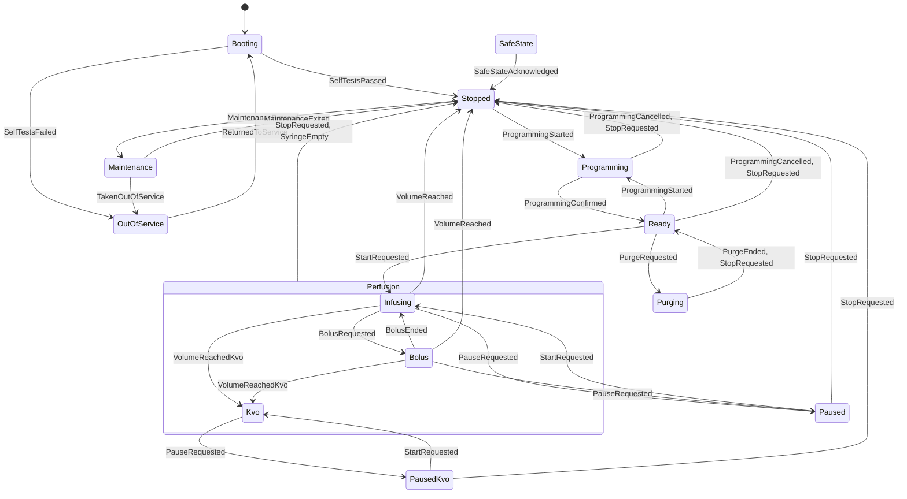

# Machine à états du logiciel de commande

| Champ | Valeur |
| --- | --- |
| Statut | Conception détaillée, soumise à relecture |
| Issue | [#24](https://github.com/camille-martin-paris/clepsydre/issues/24) |
| Exigence | SW-REQ-001 (révision D de la [spécification](../requirements/requirements-specification.md)) |
| Code | [`src/control/`](../../src/control/) : module `clepsydre.control.state_machine` |
| Classe de sécurité | C ([classification](../../software_development_file/safety-classification.md)) |

> [!CAUTION]
> Clepsydre ne doit pas être utilisé sur un être humain ni sur un animal.

## Objet

Ce document décrit la machine à états du logiciel de commande (IEC 62304 §5.4) : ses états, les événements qu'elle reçoit, la table complète des transitions et le traitement des demandes non prévues.

La machine est une **fonction pure** de l'état courant et d'un événement. Elle ne commande rien elle-même : les autres unités lisent l'état et le verdict de chaque transition.
- L'actionneur applique la borne de consigne du mode actif (SW-REQ-006).
- Les alarmes réagissent à l'état sûr et aux fins de perfusion.
- Le journal enregistre chaque transition et chaque refus.
- L'interface affiche la phase.

## Décisions retenues par l'auteur

Ambroise Leclerc a retenu ces deux décisions le 2026-10-14, avant la conception :

1. **Liste réconciliée des états.** SW-REQ-001 (révision C) et #24 ne donnaient pas la même liste, et aucune ne couvrait la purge (SYS-REQ-014, SYS-REQ-028) ni le maintien de veine ouverte (SYS-REQ-032). Or ces deux fonctions font bouger le moteur, chacune avec sa propre borne de consigne (SW-REQ-006). La liste retenue reprend les états de SW-REQ-001 :
   - elle ajoute le démarrage et la purge ;
   - elle donne à la perfusion trois modes : débit programmé, bolus, maintien de veine ouverte ;
   - elle n'a **pas d'état « Alarme »**. Les alarmes relèvent du système d'alarmes (#30) et coexistent avec les états. Celles qui imposent l'arrêt mènent à l'état sûr. SW-REQ-001 est révisée en conséquence (révision D).
2. **Demande non prévue : refus, sauf incohérence interne.**
   - Une demande non admise dans l'état courant est **refusée et journalisée, sans changer d'état**. Un appui sur « Bolus » à l'arrêt, par exemple, ne doit ni arrêter une perfusion ni déclencher d'alarme (fausses alarmes, SYS-REQ-022).
   - Une **incohérence interne** de la machine, c'est-à-dire une valeur d'état ou d'événement invalide, place la pompe en **état sûr**, ou **hors service** quand la machine ne peut plus savoir si les autotests ont réussi ([Refus et incohérences](#refus-et-incohérences)).

## États

L'énumération `State` compte 13 valeurs. Ses valeurs numériques sont stables, car elles sont transmises dans le signal de vie de la liaison ([protocole](link-protocol.md#émission)) et journalisées. `phase()` les regroupe dans les dix états de SW-REQ-001 ; `actuatorMode()` donne le mode de l'actionneur.

| Valeur | État | Phase (SW-REQ-001) | Mode de l'actionneur | Exigences |
| --- | --- | --- | --- | --- |
| 1 | `Booting` | Démarrage | aucun | SW-REQ-010, SYS-REQ-046 |
| 2 | `Stopped` | Arrêt | aucun | |
| 3 | `Programming` | Programmation | aucun | SYS-REQ-011, SW-REQ-002 |
| 4 | `Ready` | Prête | aucun | SYS-REQ-042 |
| 5 | `Purging` | Purge | purge | SYS-REQ-014, SYS-REQ-028 |
| 6 | `Infusing` | Perfusion | perfusion | SYS-REQ-029 |
| 7 | `Bolus` | Perfusion | bolus | SYS-REQ-014, SYS-REQ-029 |
| 8 | `Kvo` | Perfusion | maintien de veine ouverte | SYS-REQ-032 |
| 9 | `Paused` | Pause | aucun | SYS-REQ-042 |
| 10 | `PausedKvo` | Pause | aucun | SYS-REQ-042 |
| 11 | `SafeState` | État sûr | aucun | SYS-REQ-002 |
| 12 | `Maintenance` | Maintenance | aucun | SYS-REQ-023, SYS-REQ-041 |
| 13 | `OutOfService` | Hors service | aucun | SYS-REQ-041, SYS-REQ-046, SYS-REQ-053 |

Le mode de l'actionneur change avec l'état, en une seule transition. Aucun état intermédiaire ne mêle deux modes (SW-REQ-006). Hors des quatre modes, toute consigne non nulle est hors bornes.

La pause garde la trace du mode interrompu. `PausedKvo` reprend en maintien de veine ouverte, `Paused` au débit programmé. Un bolus interrompu par une pause n'est pas repris.

## Événements

| Valeur | Événement | Origine |
| --- | --- | --- |
| 1 | `SelfTestsPassed` | Autotests du démarrage réussis |
| 2 | `SelfTestsFailed` | Autotests du démarrage en échec (SW-REQ-010) |
| 3 | `ProgrammingStarted` | Le soignant commence ou modifie une programmation |
| 4 | `ProgrammingConfirmed` | Programmation confirmée et acceptée par le canal de sécurité (SW-REQ-013, SYS-REQ-044) |
| 5 | `ProgrammingCancelled` | Programmation abandonnée |
| 6 | `StartRequested` | Démarrer : démarrage ou reprise |
| 7 | `PauseRequested` | Pause |
| 8 | `StopRequested` | Arrêt |
| 9 | `BolusRequested` | Bolus demandé et confirmé |
| 10 | `BolusEnded` | Volume du bolus délivré |
| 11 | `PurgeRequested` | Purge demandée, ligne non raccordée établie (SYS-REQ-028) |
| 12 | `PurgeEnded` | Fin de la purge : volume atteint, ou condition de ligne perdue |
| 13 | `VolumeReached` | Volume à perfuser atteint, arrêt prévu par la bibliothèque (SYS-REQ-032) |
| 14 | `VolumeReachedKvo` | Volume à perfuser atteint, maintien de veine ouverte prévu (SYS-REQ-032) |
| 15 | `SyringeEmpty` | Seringue vide (SYS-REQ-032) |
| 16 | `DangerDetected` | Condition dangereuse : perte de lien, occlusion, air, écart de supervision, consigne hors bornes… (SYS-REQ-002) |
| 17 | `SafeStateAcknowledged` | État sûr acquitté, condition levée |
| 18 | `MaintenanceEntered` | Technicien authentifié (SYS-REQ-023) |
| 19 | `MaintenanceExited` | Fin de la maintenance |
| 20 | `TakenOutOfService` | Mise hors service par un technicien (SYS-REQ-041) |
| 21 | `ReturnedToService` | Remise en service par un technicien |
| 22 | `FatalFault` | Défaillance qui exige la mise hors service : tests de la coupure (SYS-REQ-046), désaccord de version du protocole (SYS-REQ-053), compteur de démarrage illisible (SW-REQ-020) |

Les **conditions** d'un événement sont vérifiées par l'unité qui l'émet, pas par la machine. Par exemple :
- la ligne non raccordée avant une purge ;
- le bolus réservé au mode débit continu (SYS-REQ-029) et borné par la bibliothèque ;
- l'acquittement de l'état sûr seulement une fois la condition levée ;
- l'acceptation de la programmation et des changements de mode par le canal de sécurité (SYS-REQ-044).

La machine décide seulement si l'événement est admis dans l'état courant.

## Table des transitions

### Transitions propres à un état

| État | Événement | État suivant |
| --- | --- | --- |
| `Booting` | `SelfTestsPassed` | `Stopped` |
| `Booting` | `SelfTestsFailed` | `OutOfService` |
| `Stopped` | `ProgrammingStarted` | `Programming` |
| `Stopped` | `MaintenanceEntered` | `Maintenance` |
| `Programming` | `ProgrammingConfirmed` | `Ready` |
| `Programming` | `ProgrammingCancelled`, `StopRequested` | `Stopped` |
| `Ready` | `StartRequested` | `Infusing` |
| `Ready` | `PurgeRequested` | `Purging` |
| `Ready` | `ProgrammingStarted` | `Programming` |
| `Ready` | `ProgrammingCancelled`, `StopRequested` | `Stopped` |
| `Purging` | `PurgeEnded`, `StopRequested` | `Ready` |
| `Infusing` | `PauseRequested` | `Paused` |
| `Infusing` | `BolusRequested` | `Bolus` |
| `Infusing` | `VolumeReachedKvo` | `Kvo` |
| `Infusing` | `StopRequested`, `VolumeReached`, `SyringeEmpty` | `Stopped` |
| `Bolus` | `BolusEnded` | `Infusing` |
| `Bolus` | `PauseRequested` | `Paused` |
| `Bolus` | `VolumeReachedKvo` | `Kvo` |
| `Bolus` | `StopRequested`, `VolumeReached`, `SyringeEmpty` | `Stopped` |
| `Kvo` | `PauseRequested` | `PausedKvo` |
| `Kvo` | `StopRequested`, `SyringeEmpty` | `Stopped` |
| `Paused` | `StartRequested` | `Infusing` |
| `Paused` | `StopRequested` | `Stopped` |
| `PausedKvo` | `StartRequested` | `Kvo` |
| `PausedKvo` | `StopRequested` | `Stopped` |
| `SafeState` | `SafeStateAcknowledged` | `Stopped` |
| `Maintenance` | `MaintenanceExited` | `Stopped` |
| `Maintenance` | `TakenOutOfService` | `OutOfService` |
| `OutOfService` | `ReturnedToService` | `Booting` |

Soit 37 transitions.

### Événements admis dans tous les états

| Événement | Depuis `Booting` ou `OutOfService` | Depuis tout autre état |
| --- | --- | --- |
| `DangerDetected` | `OutOfService` | `SafeState`, y compris depuis `SafeState` |
| `FatalFault` | `OutOfService` | `OutOfService` |

Au démarrage et hors service, la pompe n'a pas passé ses autotests, ou y a échoué. Une condition dangereuse y mène donc hors service, jamais à l'état sûr : l'acquittement de l'état sûr ramènerait à l'arrêt **sans autotests**. La remise en service repasse toujours par le démarrage et ses autotests.

### Refus et incohérences

- **Refus** : tout autre couple (état, événement), valide, est refusé. Sur les 13 × 22 = 286 couples, 63 sont admis : les 37 transitions propres, plus deux événements dans 13 états ; les 223 autres sont refusés. L'état ne change pas, et le verdict `Refused` permet à l'appelant de journaliser le refus (SW-REQ-001).
- **Incohérence interne** : une valeur hors de l'énumération, par exemple après une corruption de la mémoire, donne le verdict `InternalFault`.
  - **État invalide** : la pompe passe **hors service**, quel que soit l'événement, `FatalFault` compris. Un état invalide ne dit pas si les autotests ont réussi. L'état sûr ne convient donc pas : son acquittement ramènerait à l'arrêt, puis permettrait programmation et démarrage sans autotests. La remise en service repasse par le démarrage et ses autotests.
  - **Événement invalide** depuis un état valide : état sûr, ou hors service depuis le démarrage et hors service, comme `DangerDetected`.

  `phase()` présente un état invalide comme hors service, et `actuatorMode()` n'y admet aucune consigne.

### Conséquences voulues

- **Purge avant le premier démarrage seulement** (SYS-REQ-014) : la purge n'est admise que depuis `Ready`, et la machine n'y revient pas une fois la perfusion démarrée. La pause et l'arrêt ne ramènent pas à `Ready`.
- **Pas de nouvelle programmation pendant une perfusion** (SYS-REQ-044) : `ProgrammingStarted` n'est admis qu'à l'arrêt ou prête. Changer de débit exige d'arrêter puis de reprogrammer.
- **Pas de reprise depuis l'état sûr** (ADR 0003) : l'acquittement mène à l'arrêt, et la programmation est perdue. La proposition de reprise après une réinitialisation (SYS-REQ-038) passe par une nouvelle programmation au volume restant, préparée par une autre unité.
- **Fin de perfusion** (SYS-REQ-032) : à l'atteinte du volume, la machine passe à l'arrêt ou au maintien de veine ouverte selon l'événement reçu, choisi par la bibliothèque.
  - Cela vaut aussi **pendant un bolus** : le volume à perfuser peut être atteint avant la fin du bolus, qui est alors abandonné.
  - Une fin de bolus qui arrive ensuite est refusée, sans revenir au débit programmé.
  - La seringue vide arrête la perfusion dans tous ses modes.

## Diagramme

Les transitions vers `SafeState` et `OutOfService` ouvertes depuis tous les états (`DangerDetected`, `FatalFault`) sont omises pour la lisibilité.

## Ressources et traitement des défauts

- **Mémoire** : un octet d'état ; une table constante de 37 règles en mémoire morte. Aucune allocation dynamique.
- **Exceptions** : toutes les fonctions sont `noexcept` et ne lèvent pas d'exception.
- **Fonction totale** : `transition()` a un résultat pour toute valeur de ses arguments, même invalide.
- **Temps d'exécution** : borné par le parcours de la table, 37 règles au plus.

## Vérification

`tests/control_state_machine_test.cpp` contient sa propre table des transitions attendues, écrite d'après ce document indépendamment de celle du code.

| Critère (IEC 62304 §5.5.4) | Couverture par les tests |
| --- | --- |
| Séquences d'événements | Les 286 couples (état, événement) comparés un par un à la table attendue, avec l'état suivant et le verdict ; trois parcours complets (purge, perfusion, bolus, pause, maintien de veine ouverte, arrêt ; état sûr et acquittement ; maintenance, mise hors service, remise en service, autotests en échec) ; volume atteint pendant un bolus, pour les deux politiques de fin, avec la fin du bolus avant ou après |
| Flux de contrôle | Nombre exact de transitions admises (63) ; aucune incohérence interne sur des valeurs valides |
| Traitement des défauts | États invalides (0, juste au-delà de la plage, 255) avec chaque événement, valide ou non : hors service. Événements invalides depuis chaque état : état sûr, ou hors service depuis le démarrage et hors service. Récupération après un état invalide : seuls la remise en service puis des autotests réussis ramènent à l'arrêt |
| Conditions aux limites | Premières et dernières valeurs des énumérations ; valeurs numériques stables vérifiées |
| Initialisation | La machine démarre en `Booting` |
| Couverture structurelle | 100 % des régions et des branches, sans exclusion (tâche CI `coverage`) |

Ces tests vérifient l'unité (VER-052 en prévoit l'analyse au niveau unitaire). La vérification d'intégration de SW-REQ-001 (VER-051) viendra avec le logiciel de commande assemblé.

## Limites

- La machine ne vérifie pas les conditions des événements : elle fait confiance à l'unité qui les émet. Ces conditions seront conçues et vérifiées avec chaque unité : purge et ligne non raccordée, bolus, acquittement, canal de sécurité.
- Le journal des transitions et des refus n'existe pas encore (#41). La machine fournit le verdict, et l'appelant devra le journaliser.
- Les délais (rappel de pompe inactive SYS-REQ-042, préalarmes de fin) relèvent des alarmes et des unités qui émettent les événements.
- La machine du canal de sécurité, qui n'admet que certains changements de mode (SYS-REQ-044), est distincte et sera conçue avec #29.
